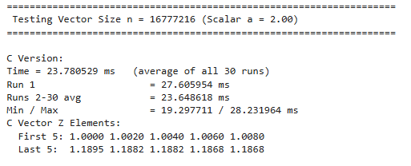
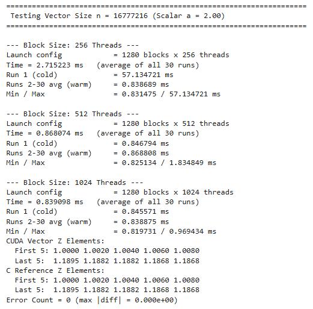
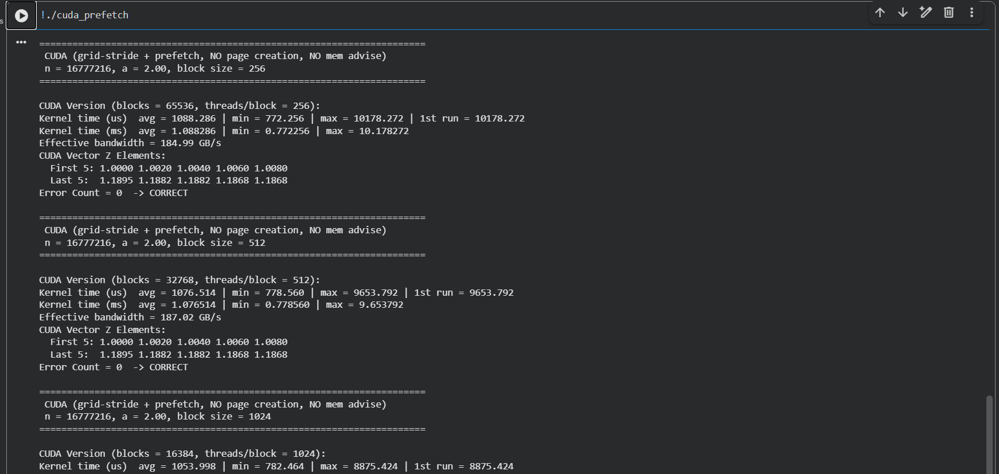
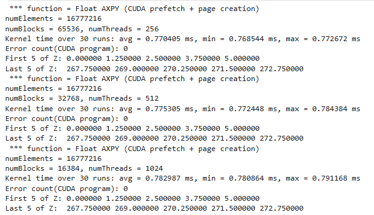
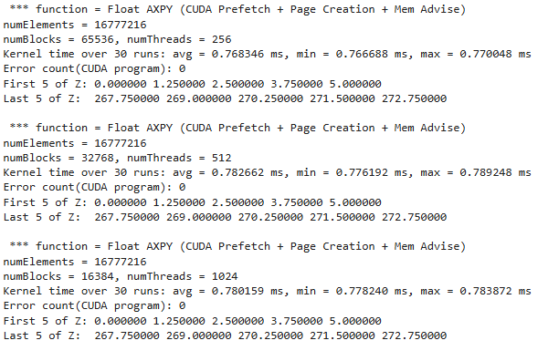
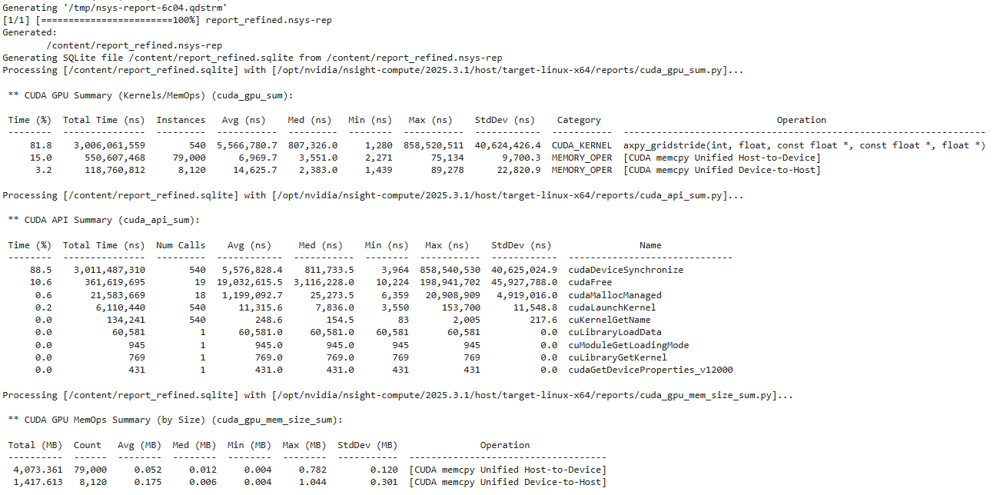
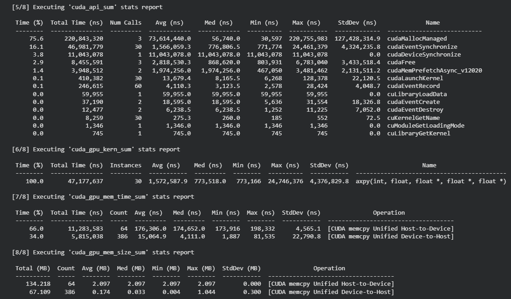
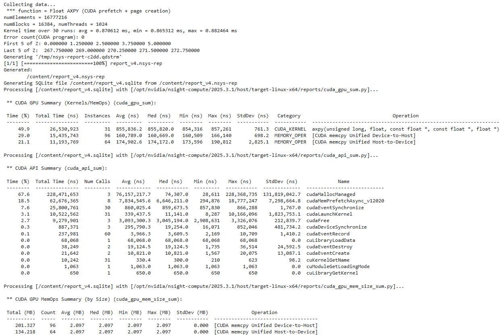
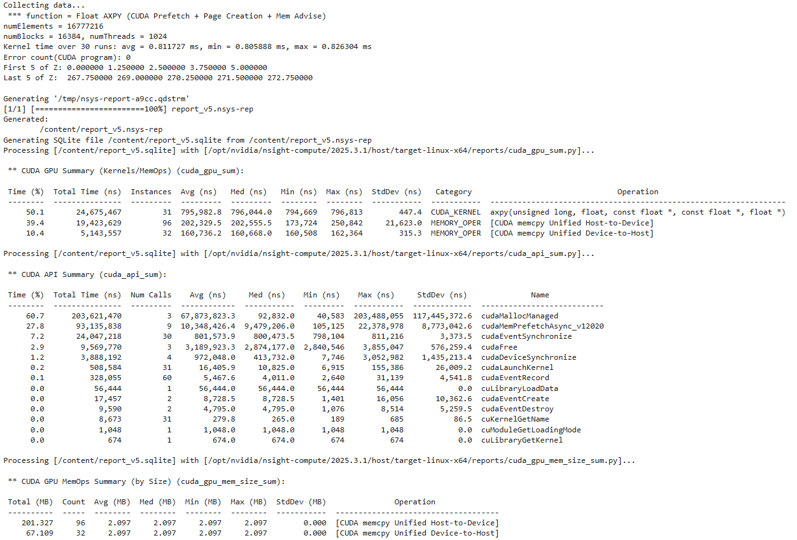

# CEPARCO_GRP3_CUDA
## Members:
* Alcasid, Aizy
* Bilanes, Kendrick
* Corpuz, Gerald
* Roa, Luis

# Deep Dive: CUDA Concepts and Programming
## Project Specifications
**Kernel:** Vector AXPY on vectors $A$ and $B$, placing the result in vector $Z$.

**Input:** 
* Scalar variable $n$ (integer) contains the length of the vector.
* Scalar variable $a$ (single-precision float).
* Vectors $A$ and $B$ are single-precision floats.

**Process:**
$Z_i = a \cdot X_i + Y_i$ for $i = 0, 1, \dots, n-1$

**Output:** 
Store the result in vector $Z$. Display the execution time, the first 5, and the last 5 elements of vector $Z$ for verification across all kernels.

**Variants to be implemented:**
1. C/C++ program version
2. CUDA program version using a grid-stride loop without prefetch and without mem advise
3. CUDA program version using a grid-stride loop with prefetching but without page creation and without mem advise
4. CUDA program version using a grid-stride loop with prefetch, with page creation but without mem advise
5. CUDA program version using a grid-stride loop with prefetch, with page creation and with mem advise
   
## AI Usage Declaration

---

## I. Program Output and Correctness Check

**Variant 1: C/C++ Version**

**Variant 2: No Prefetch, No Mem Advise**

**Variant 3: With Prefetch, No Page Creation, No Mem Advise**

**Variant 4: With Prefetch, With Page Creation, No Mem Advise**

**Variant 5: With Prefetch, With Page Creation, With Mem Advise**

## II. NSYS Profiling

**Variant 2: No Prefetch, No Mem Advise**

**Variant 3: With Prefetch, No Page Creation, No Mem Advise**

**Variant 4: With Prefetch, With Page Creation, No Mem Advise**

**Variant 5: With Prefetch, With Page Creation, With Mem Advise**

---

## III. Comparative Table of Execution Time

| 2^24 elements | | |
| :--- | :--- | :--- |
| **CUDA block size = [256 \| 512 \| 1024]** | **Kernel time [avg \| min \| max] in ms** | **Speedup vs baseline C program** |
| C | [23.780529 \| 19.297711 \| 28.231964] | N/A |
| x86-64 | avg: 9.132447 | 2.60 |
| x86-64 SIMD XMM | avg: 7.635550 | 3.11 |
| x86-64 SIMD YMM | avg: 7.358211 | 3.23 |
| CUDA Unified (No Prefetch/Advise) | 256: [0.838689 \| 0.831475 \| 57.134721] 512: [0.868808 \|0.825134  \|1.834849] 1024: [0.838875 \| 0.819731 \|0.969434] | 256: [28.35] 512: [27.37] 1024: [28.35] | |
| CUDA Prefetch (No Page Creation) | [avg \| min \| max] | [value] |
| CUDA Prefetch + Page Creation | 256: [0.770405 \| 0.768544 \| 0.772672] 512: [0.775305 \| 0.772448 \| 0.784384] 1024: [0.782987 \| 0.780864 \| 0.791168] | 256: 30.87 512: 30.67 1024: 30.37 |
| CUDA Prefetch + Page Creation + Mem Advise| 256: [0.768346 \|0.766688 \| 0.770048] 512: [0.782662 \| 0.776192 \| 0.789248] 1024: [0.780159 \| 0.778240 \| 0.783872] | 256: 30.78 512: 30.22 1024: 30.31|

---

## IV. Analysis of Results

### 1. Analysis of Kernel Execution Time
[Discuss the execution times observed across the different CUDA variants and baseline programs. Identify trends, minimums, maximums, and averages.]

### 2. Analysis of Speed Performance Across All Platforms
[Compare the speedup across C, x86-64, SIMD (XMM/YMM), and the CUDA variants. Which platform performed the best and why?]

### 3. Impact of Block Size
**Question:** How does block size affect execution time (observing various elements and using max blocks)? Which block size will you recommend?

[Provide your analysis and recommendation here...]

### 4. Memory Management: Prefetching vs. CUDA Managed
**Question:** Is prefetching always recommended, or should CUDA manage memory? Give some use cases in which one is better than the other.

[Provide your analysis and use cases here...]

### 5. SIMD vs SIMT Performance
**Question:** Between SIMD and SIMT, which one is faster? Give some use cases in which one is better than the other.

[Provide your comparison and use cases here...]

---

## V. Experience and Methodology
   Comparing the traditional CPU approach with the four GPU implementations shows a dramatic speed improvement when moving to graphics card processing. The standard CPU implementation takes roughly around 23.65 ms to process 16.77 million data elements. By contrast, even a basic GPU configuration drops that time down to around 0.84 ms, which gives us around a 28x speedup. This massive difference happens because GPUs contain thousands of processing cores working simultaneously, making them exceptionally efficient at running simple math calculations across massive batches of data.

   However, getting peak performance out of a GPU requires carefully managing how memory moves between the computer's system RAM and the graphics card. In the basic GPU setup, the graphics card constantly pauses execution to request data on-demand, causing a huge initial delay of over 100 ms on the very first run. By prefetching the data, telling the system to transfer all necessary information to the graphics card before the calculations begin, this startup lag is completely eliminated, bringing execution time down.
	
   It is also worth mentioning the group’s realization, upon testing the outputs, that the outputs might be varying due to our personal machines' speed, even when running the same code. Eventually, we decided to just keep the outputs the same as the ones that made them. This is worth taking into account, as it would probably be a reason for having ‘weird’ comparisons in the outputs. This was also evident in the previous SIMD project, and it helped us realize this factor.

---

## VI. SIMD vs SIMT Handling Parallelism

   While CPU vector processing (SIMD) and GPU parallel execution (SIMT) both process multiple data values at once, they handle the execution differently. SIMD relies on a single CPU core issuing one vector instruction that acts on a fixed block of packed data registers. On the other hand, SIMT uses thousands of lightweight threads running the same program across independent lanes, where the GPU hardware automatically manages instruction issuing, thread grouping, and branch execution. In practice, SIMD is ideal for low-latency sequential logic with mild vectorization, while SIMT excels at massive data-parallel workloads like vector math, though performance drops significantly if memory transfers aren't properly managed.
   
SIMD (Single Instruction, Multiple Data)
PROS:
* Lower latency for individual operations
* No need to move data back and forth over a PCIe bus since memory stays on system RAM.
* Predictable execution without the overhead of managing thousands of concurrent threads.
CONS:
* Limited core count and smaller vector widths yield much lower total throughput for massive datasets.
* Constrained by CPU memory bandwidth limits when processing millions of elements.
  
SIMT (Single Instruction, Multiple Threads)
PROS:
* Massive thread parallelism that provides high speedups on memory-heavy vector math.
* Hardware automatically hides latency by switching to another thread group when one group is waiting on memory.
* Easily scales across large datasets using simple grid loops without needing manual vector register instructions.
CONS:
* Suffers high performance penalties if memory isn't prefetched or managed properly.
* Complex branching or conditional logic inside threads can slow down overall execution speed.

---

